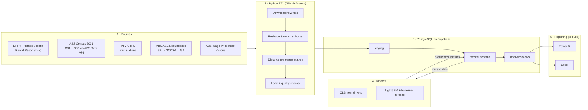

# melb-rent-watch

**Melbourne Rental Affordability Intelligence Platform**: where in Greater Melbourne is rent affordable relative to local income, and how does that relate to access to the train network?

The platform automatically downloads public data every quarter, models it into a PostgreSQL star schema on Supabase, fits an explanatory regression and a next-quarter forecast, and exposes everything through `analytics` views for Power BI and Excel.

| Question | Where it's answered |
|---|---|
| Lowest rent-to-income near a train station? | `analytics.v_affordability` (`rent_to_income_pct`, `distance_to_station_km`) |
| How fast is rent growing, and where is it accelerating? | `analytics.v_rent_growth` (`qoq_growth_pct`, `yoy_growth_pct`, `rolling_4q_avg_rent`) |
| How big is the "train premium"? | `reports/regression_summary.md`, `analytics.v_regression_coefficients` |
| Expected median rent next quarter? | `analytics.v_rent_forecast`, `reports/forecast_summary.md` |

## Architecture



## Data sources

| Data | Source | How it's fetched |
|---|---|---|
| Median rents and new-bond counts by suburb group, quarter and dwelling type (Mar 2000 onwards) | [DFFH Rental Report](https://www.dffh.vic.gov.au/publications/rental-report): *Moving annual median rent by suburb and town* | The landing page is scraped for the link; only quarters not already in `data/raw/rental/` are downloaded |
| Median weekly household income (G02) and population (G01) by suburb (SAL) | ABS Census 2021 via the [ABS Data API](https://data.api.abs.gov.au) | SDMX CSV; fetched once |
| Wage Price Index, Victoria (total hourly rates excl. bonuses, original) | ABS Data API, dataflow `WPI` | Refreshed every run |
| Train stations (metro + V/Line inside Greater Melbourne) | [PTV GTFS feed](https://data.ptv.vic.gov.au/downloads/gtfs.zip), parent stations (`location_type = 1`) | Refreshed if older than 90 days |
| Suburb, Greater Melbourne and LGA boundaries | ABS ASGS Edition 3 (2021) shapefiles | Fetched once |

Every download is recorded with its SHA-256 in `data/raw/manifest.json` and in `dw.etl_run_log`. URLs, sheet names and filters live in [config/sources.yaml](config/sources.yaml).

## Setup

```bash
python -m venv .venv
.venv\Scripts\activate            # Windows  (source .venv/bin/activate on macOS/Linux)
pip install -r requirements.txt
copy .env.example .env            # then put your Supabase session-pooler URI in DATABASE_URL
```

Supabase: *Project Settings → Database → Connection string → Session pooler*, with `?sslmode=require`.

## Running

```bash
python -m src.pipeline                      # download, transform, load, check, model
python -m src.pipeline --force              # reload the latest quarter even if already loaded
python -m src.pipeline --skip-models        # ETL only
python -m src.pipeline --rental-file "Moving annual median rent by suburb and town - June Quarter 2026.xlsx"
python -m pytest -q                         # unit tests
```

The first run downloads ~450 MB of boundaries and GTFS. Later runs reuse them.

If the DFFH website doesn't respond to scripted requests, download the workbook in a browser and pass it with `--rental-file`.

The DFFH site regularly times out for cloud servers such as GitHub Actions. When that happens, the scheduled run doesn't turn red every week:
- If the latest loaded quarter is less than 210 days old (`quality.max_data_age_days`), the run passes with a warning.
- Once the data is older than that, a newer quarter is almost certainly out, so the run fails with instructions. Download the new workbook in a browser and run the pipeline locally with `--rental-file`.

### GitHub Actions

| Workflow | Schedule | What it does |
|---|---|---|
| `quarterly_refresh.yml` | Weekly (Mon 20:00 UTC) + manual | Tests, then the pipeline; exits early if the quarter is already loaded. Fails if any quality check fails |
| `maintenance.yml` | Every 3 days / Sundays | Keep-alive query so the free Supabase project doesn't pause; weekly `pg_dump` of `dw` + `analytics` as a 30-day artifact |
| `tests.yml` | Every push / PR | Unit tests |

Add one repository secret: **`DATABASE_URL`** (Settings → Secrets and variables → Actions).

## Repository layout

```
config/sources.yaml          source URLs, sheet map, metro regions, thresholds
data/raw/                    downloads (git-ignored), manifest.json
data/interim/                intermediate CSVs (git-ignored)
data/reference/              suburb_overrides.csv (hand-maintained), suburb_crosswalk.csv (generated)
src/ingest/                  download_rental / download_income / download_stations, manifest
src/transform/               reshape_rental, clean_suburbs, geo_distance, suburb_attributes
src/load/load_warehouse.py   DDL, staging COPY, merge, views, quality checks, run log
src/models/                  regression.py, forecast.py
src/pipeline.py              orchestrates a full run
sql/01–06                    schemas, dimensions, facts, views, quality checks, staging→dw merge
sql/07_roles.sql             read-only / pipeline roles (run once by hand)
notebooks/                   01_eda, 02_models
reports/                     model write-ups regenerated on each run
powerbi/, excel/             reporting files (to build)
```

## Warehouse

**Grain:** one row per DFFH suburb group × quarter × property type (1/2/3-bed flat, 2/3/4-bed house). DFFH data is aggregated, not individual bonds.

| Table | Contents |
|---|---|
| `dw.fact_rental_bonds` | Median weekly rent and new-bond count. Suppressed cells are stored as `NULL` rows, so every series is contiguous |
| `dw.dim_suburb` | 110 metro suburb groups: region, LGA, population-weighted location, nearest station, distance band, Census income |
| `dw.bridge_suburb_sal` | Suburb group → ABS SAL codes (193 suburbs), with match method |
| `dw.dim_date` | Quarter spine incl. four future quarters for forecasts |
| `dw.dim_property_type`, `dw.dim_station`, `dw.ref_wage_index` | Property types, train stations, WPI |
| `dw.fact_rent_forecast`, `dw.model_backtest_metrics`, `dw.model_regression_coefficients` | Model outputs |
| `dw.etl_run_log` | Every download, load, quality check and model run |

**Views for reporting** (connect Power BI / Excel to these only):

| View | Use |
|---|---|
| `analytics.v_affordability` | Main reporting table: rent, growth, indexed income, rent-to-income %, affordability band, distance, coordinates |
| `analytics.v_rent_growth` | QoQ / YoY growth, rolling 4Q average, cheapest rank |
| `analytics.v_rent_forecast` | Actuals plus latest forecast with 80% interval (`is_forecast` flag) |
| `analytics.v_suburbs`, `analytics.v_suburb_sal`, `analytics.v_stations` | Map layers and lookups |
| `analytics.v_model_metrics`, `analytics.v_regression_coefficients`, `analytics.v_refresh_info` | Methodology page |

### Quality checks (every load)

These are defined in [sql/05_quality_checks.sql](sql/05_quality_checks.sql) and logged to `dw.etl_run_log`:
- duplicate staging keys
- rent outside $50–$3,000/week
- negative bond counts
- fact rows without dimensions
- staging rows not loaded
- latest quarter's row count more than 10% different from the previous quarter
- non-contiguous series
- suburbs with no SAL mapping or missing income or distance
- missing WPI base quarter

## Method notes

- **Suburb matching:** names are normalised (case, dashes, `(Vic.)` suffixes, `Mt` → `Mount`), groups are split on `-`, then each part is matched exactly or fuzzily (rapidfuzz token-sort ≥ 90, which handles "East Hawthorn" → "Hawthorn East"). Rows in `data/reference/suburb_overrides.csv` replace the automatic split for a group: "CBD-St Kilda Rd", "Yarra Ranges", and the range groups "Dromana-Portsea" and "Hastings-Flinders". Any new unmatched name stops the pipeline and is written to `data/reference/unmatched_suburbs.csv`.
- **Distance:** straight-line (haversine) distance from each suburb's representative point to the nearest parent station, via `BallTree`. Group values are population-weighted means of their suburbs.
- **Income:** a population-weighted mean of SAL median household incomes. That approximates the group median and is not a true median. Census income (August 2021) is indexed to each quarter with the Victorian WPI (base: Sep 2021 quarter). The latest WPI is carried forward when a rent quarter is newer than the latest WPI release.
- **Affordability bands:** under 25% Affordable, 25–30% Moderate, 30% or more Rental stress. All are calculated on indexed income.
- **Reliability:** rows with fewer than 10 new bonds are flagged `is_reliable = false`.
- **Regression:** OLS, `log(rent) ~ log(distance) + bedrooms + dwelling type + log(indexed income) + region`, on the latest four quarters averaged. A second model swaps log distance for distance bands to estimate the train premium. It uses HC3 standard errors and reports VIF, Breusch–Pagan and Moran's I on residuals. These are associations, not causal effects.
- **Forecast:** naive, seasonal-naive and drift baselines vs a panel LightGBM model on next-quarter log growth, using an expanding-window backtest over 8 quarters. Whichever model has the lowest backtest MAPE is published, so an ML model that can't beat the baselines never replaces them. The 80% interval comes from quantile LightGBM, or from empirical backtest errors for baselines.

## Limitations

- **Moving annual medians:** DFFH figures cover leases started in the past 12 months, so the series lags the market and is smooth. QoQ growth is growth in that moving annual median.
- **Grouped suburbs:** DFFH reports groups such as "Carlton-Parkville", so variation within a group is hidden. Range groups and "Yarra Ranges" are mapped to their main townships, which is an approximation.
- **Dated income:** Census income is from 2021 and is only adjusted for average wage growth. It does not capture local changes in who lives where.
- **Straight-line distance:** the plan's stretch goal is walking-network distance with OSMnx.

## Status

- [x] Ingestion, transformation, warehouse, quality checks, models, automation, tests
- [ ] Power BI report (`powerbi/`)
- [ ] Excel stakeholder workbook (`excel/`)
